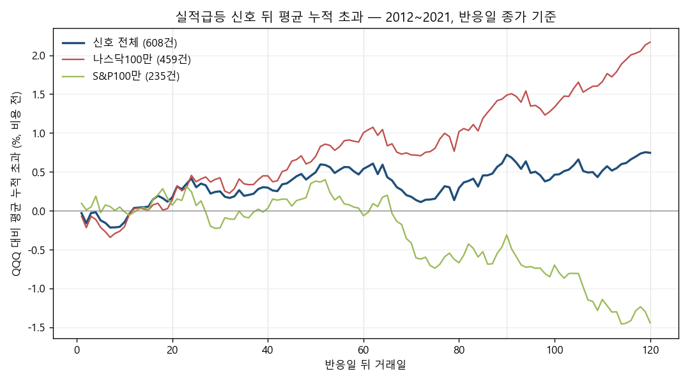

# 실적급등 타이밍 탐색 — 결과

> 계획: `docs/research/pead_timing_plan.md` (태그 `pead-timing-plan` = 커밋 `9406548`, 실행 시 작업 폴더와 같음 확인) · 실행 코드 커밋 `7876437` · 계산 1회
> 탐색이지 판정이 아니다. 25칸을 한 번에 본 결과라 가장 좋은 칸의 숫자는 위로 치우쳐 있다.

- 신호: SW1 그대로(나스닥100 ∪ S&P100, 반응일 +5%·QQQ 대비 +5%p·거래량 2배), 반응일 2012~2021, 636건 재현 확인
- 초과 = 신호 종목 − 같은 날·같은 가격 종류로 사고판 QQQ, 원화 비용(수수료 0.07%·환전 0.1% 편도)·세금(매도 연도 장부 순이익 22%) 뒤
- 무작위: 같은 매수일·같은 예정 매도일, 매수일 전 달 말 명단 무작위 1종목, 1000회, 시드 20261111
- 점검: B1·60 = SW1 결과(601건, +0.53%), 2022~ B1·60 = 봉인 ⓐ 결과(382건, −0.21%) 재현 확인

## 선택: **B1 다음 날 시가 · 90거래일 보유**

- 1단계(두 구간 모두 > 0): 12칸 — B1·20, B1·60, B1·90, B2·20, B2·90, B3·20, B3·60, B3·90, B4·20, B4·40, B4·60, B4·90
- 2단계(+ 상하좌우 이웃 평균 > 0): 12칸 — B1·20 (100.0백분위), B1·60 (100.0백분위), B1·90 (100.0백분위), B3·90 (100.0백분위), B2·90 (99.9백분위), B3·20 (99.8백분위), B2·20 (99.7백분위), B3·60 (99.7백분위), B4·20 (99.7백분위), B4·60 (99.7백분위), B4·90 (99.7백분위), B4·40 (99.3백분위)
- 3단계: 그중 무작위 백분위 최고 → B1·90 (100.0백분위, 평균 +0.67%, 2012~16 +1.08% / 2017~21 +0.23%, 매매 549)

## 평균 초과 (비용·세금 뒤, 매매당) — 히트맵

🟩 ≥ +0.5% · 🟢 0 ~ +0.5% · 🟠 −0.5% ~ 0 · 🔴 ≤ −0.5% · ◀ 선택

| 매수 \ 보유 | 20일 | 40일 | 60일 | 90일 | 120일 |
| --- | --- | --- | --- | --- | --- |
| B1 다음 날 시가 | 🟢 +0.42% | 🟢 +0.38% | 🟩 +0.53% (기준) | **🟩 +0.67% ◀** | 🟩 +0.57% |
| B2 다음 날 종가 | 🟢 +0.23% | 🟢 +0.17% | 🟢 +0.34% | 🟢 +0.46% | 🟢 +0.36% |
| B3 +3일 종가 | 🟢 +0.22% | 🟢 +0.23% | 🟢 +0.26% | 🟢 +0.31% | 🟢 +0.10% |
| B4 +5일 종가 | 🟢 +0.23% | 🟢 +0.34% | 🟢 +0.26% | 🟢 +0.29% | 🟢 +0.03% |
| B5 되돌림 | 🟢 +0.16% | 🟢 +0.30% | 🟢 +0.45% | 🟢 +0.43% | 🟠 -0.20% |

## 무작위 1,000회 백분위

| 매수 \ 보유 | 20일 | 40일 | 60일 | 90일 | 120일 |
| --- | --- | --- | --- | --- | --- |
| B1 다음 날 시가 | 100.0 | 99.9 | 100.0 | 100.0 | 100.0 |
| B2 다음 날 종가 | 99.7 | 99.5 | 100.0 | 99.9 | 100.0 |
| B3 +3일 종가 | 99.8 | 99.4 | 99.7 | 100.0 | 99.9 |
| B4 +5일 종가 | 99.7 | 99.3 | 99.7 | 99.7 | 99.4 |
| B5 되돌림 | 99.0 | 99.1 | 100.0 | 100.0 | 99.8 |

## 2012~2016 / 2017~2021 평균 초과

| 매수 \ 보유 | 20일 | 40일 | 60일 | 90일 | 120일 |
| --- | --- | --- | --- | --- | --- |
| B1 다음 날 시가 | +0.62% / +0.21% | +0.90% / -0.17% | +0.91% / +0.12% | +1.08% / +0.23% | +1.26% / -0.18% |
| B2 다음 날 종가 | +0.39% / +0.06% | +0.66% / -0.34% | +0.70% / -0.06% | +0.84% / +0.05% | +1.04% / -0.38% |
| B3 +3일 종가 | +0.31% / +0.13% | +0.60% / -0.16% | +0.44% / +0.08% | +0.49% / +0.12% | +0.58% / -0.42% |
| B4 +5일 종가 | +0.21% / +0.24% | +0.59% / +0.08% | +0.41% / +0.11% | +0.41% / +0.15% | +0.34% / -0.31% |
| B5 되돌림 | +0.41% / -0.10% | +0.92% / -0.36% | +0.91% / -0.02% | +0.94% / -0.11% | +0.65% / -1.11% |

## 중앙값 초과 · 승률

| 매수 \ 보유 | 20일 | 40일 | 60일 | 90일 | 120일 |
| --- | --- | --- | --- | --- | --- |
| B1 다음 날 시가 | +0.05% · 50% | +0.28% · 51% | -0.28% · 48% | +0.21% · 51% | -0.13% · 49% |
| B2 다음 날 종가 | -0.26% · 49% | -0.20% · 49% | -0.13% · 49% | +0.07% · 50% | -0.35% · 50% |
| B3 +3일 종가 | +0.03% · 50% | -0.07% · 49% | -0.16% · 49% | -0.16% · 49% | -0.08% · 50% |
| B4 +5일 종가 | -0.03% · 50% | -0.20% · 49% | +0.01% · 50% | +0.02% · 50% | +0.05% · 50% |
| B5 되돌림 | -0.19% · 48% | +0.21% · 51% | +0.31% · 51% | +0.62% · 52% | -0.85% · 48% |

## 매매 수 · 평균 초과 비용 전(달러)

| 매수 \ 보유 | 20일 | 40일 | 60일 | 90일 | 120일 |
| --- | --- | --- | --- | --- | --- |
| B1 다음 날 시가 | 630 · +0.55% | 626 · +0.51% | 601 · +0.73% | 549 · +0.89% | 528 · +0.95% |
| B2 다음 날 종가 | 630 · +0.30% | 626 · +0.26% | 601 · +0.49% | 549 · +0.62% | 528 · +0.70% |
| B3 +3일 종가 | 630 · +0.30% | 624 · +0.31% | 591 · +0.37% | 549 · +0.45% | 515 · +0.32% |
| B4 +5일 종가 | 630 · +0.31% | 621 · +0.47% | 565 · +0.37% | 547 · +0.44% | 507 · +0.24% |
| B5 되돌림 | 630 · +0.20% | 619 · +0.38% | 558 · +0.59% | 547 · +0.64% | 496 · -0.05% |

## 고르는 규칙 칸별 판단

✔ 두 구간 > 0 · ◇ 이웃 평균 모두 > 0

| 매수 \ 보유 | 20일 | 40일 | 60일 | 90일 | 120일 |
| --- | --- | --- | --- | --- | --- |
| B1 다음 날 시가 | ✔◇ | ·◇ | ✔◇ | ✔◇ | ·◇ |
| B2 다음 날 종가 | ✔◇ | ·◇ | ·◇ | ✔◇ | ·◇ |
| B3 +3일 종가 | ✔◇ | ·◇ | ✔◇ | ✔◇ | ·◇ |
| B4 +5일 종가 | ✔◇ | ✔◇ | ✔◇ | ✔◇ | ·· |
| B5 되돌림 | ·◇ | ·◇ | ·◇ | ·· | ·◇ |

## 평균 누적 초과 곡선 (참고, 선택에 안 씀)

| 반응일 뒤 | 신호 전체 | 나스닥100만 | S&P100만 |
| --- | --- | --- | --- |
| 1일 | -0.03% | -0.07% | +0.09% |
| 3일 | -0.03% | -0.07% | +0.05% |
| 5일 | -0.12% | -0.21% | -0.02% |
| 10일 | -0.15% | -0.20% | -0.01% |
| 20일 | +0.17% | +0.14% | +0.07% |
| 40일 | +0.30% | +0.45% | +0.03% |
| 60일 | +0.54% | +1.00% | -0.06% |
| 90일 | +0.72% | +1.49% | -0.31% |
| 120일 | +0.74% | +2.17% | -1.44% |

- 신호 단위(겹침 규칙 없음), 반응일 + 120거래일이 2021-12-31 안인 신호, 비용 전 달러. 나스닥100·S&P100 양쪽 명단이면 둘 다에 들어감.

## 2022 ~ 2026-09 (봉인 ⓐ, 이미 개봉) — 참고만

| 칸 | 매매 | 평균 초과(세금 뒤) | 중앙값 | 승률 | 2022~23 / 2024~26 | 무작위 백분위 |
| --- | --- | --- | --- | --- | --- | --- |
| B1·60 | 382 | -0.21% | -1.35% | 45.3% | -0.56% / +0.02% | 94.7 |
| B1·90 | 336 | -0.69% | -1.84% | 45.5% | +0.06% / -1.21% | 94.8 |

- 같은 방법(봉인 ⓐ 데이터·매도 예정일 2026-09-30 이내). 계획 9절대로 이 두 칸 말고는 계산하지 않았다.

## 데이터 공백

| 항목 | 값 |
| --- | --- |
| 실적 발표 중 판정 못 함 (가격·시각·이력 부족, SW1과 같음) | 198/6622 (3.0%) |
| 명단 티커 중 가격 있음 | 279/301 |
| 종목·달 범위 (계획서 SW1 2장) | 나스닥100 88.5%, S&P 100 97.5% |

칸마다 매매 안 된 신호 (636건 중):

| 칸 | 매매 | 안 됨 | 사유 |
| --- | --- | --- | --- |
| B1·20 | 630 | 6 | 봉인 경계 6 |
| B1·40 | 626 | 10 | 봉인 경계 10 |
| B1·60 | 601 | 35 | 보유 중 19, 봉인 경계 16 |
| B1·90 | 549 | 87 | 보유 중 71, 봉인 경계 16 |
| B1·120 | 528 | 108 | 보유 중 80, 봉인 경계 28 |
| B2·20 | 630 | 6 | 봉인 경계 6 |
| B2·40 | 626 | 10 | 봉인 경계 10 |
| B2·60 | 601 | 35 | 보유 중 19, 봉인 경계 16 |
| B2·90 | 549 | 87 | 보유 중 71, 봉인 경계 16 |
| B2·120 | 528 | 108 | 보유 중 80, 봉인 경계 28 |
| B3·20 | 630 | 6 | 봉인 경계 6 |
| B3·40 | 624 | 12 | 봉인 경계 12 |
| B3·60 | 591 | 45 | 보유 중 29, 봉인 경계 16 |
| B3·90 | 549 | 87 | 보유 중 71, 봉인 경계 16 |
| B3·120 | 515 | 121 | 보유 중 93, 봉인 경계 28 |
| B4·20 | 630 | 6 | 봉인 경계 6 |
| B4·40 | 621 | 15 | 봉인 경계 14, 보유 중 1 |
| B4·60 | 565 | 71 | 보유 중 56, 봉인 경계 15 |
| B4·90 | 547 | 89 | 보유 중 71, 봉인 경계 18 |
| B4·120 | 507 | 129 | 보유 중 101, 봉인 경계 28 |
| B5·20 | 630 | 6 | 봉인 경계 6 |
| B5·40 | 619 | 17 | 봉인 경계 14, 보유 중 3 |
| B5·60 | 558 | 78 | 보유 중 63, 봉인 경계 15 |
| B5·90 | 547 | 89 | 보유 중 71, 봉인 경계 18 |
| B5·120 | 496 | 140 | 보유 중 114, 봉인 경계 26 |

## 결과를 본 뒤 바꾼 점

없음 (규칙·숫자·코드 그대로)

## 결과를 본 뒤 덧붙인 메모 (읽을 때 주의, 선택은 그대로)

- **백분위가 칸을 거의 못 가렸다.** 무작위 평균 초과 중앙값이 칸마다 −0.38% ~ −1.95%(같은 시기 대형주 무작위 1종목이 QQQ에 뒤처짐)라
  25칸 모두 99.0 이상이고, 2단계를 통과한 칸 중 B1·20·B1·60·B1·90·B3·90 네 칸이 정확히 100.0(1,000회 모두보다 높음)으로 같았다.
  실제 선택은 동점 규칙(평균 큰 칸)이 했다 — B1·90 +0.67% vs B1·60 +0.53% vs B1·20 +0.42% vs B3·90 +0.31%.
- **평균과 중앙값이 다르다.** 중앙값은 대부분 칸에서 0 근처이거나 음수이고 승률은 48~52%. 평균 초과는 소수의 큰 상승에서 나온다.
- **늦게 살수록 낮다.** 같은 보유 기간에서 B1(다음 날 시가)이 거의 모든 열에서 가장 높다. 누적 곡선도 반응일 뒤 10거래일까지 −0.15% 근처로 조금 밀렸다가 오르므로,
  "기다렸다 사기"(B3·B4·B5)가 B1보다 나은 칸은 없다.
- **2017~2021은 모든 칸이 +0.25% 이하.** 2012~2016이 평균을 끌어올린다.
- **나스닥100과 S&P100이 반대다.** 곡선에서 나스닥100만은 120일까지 +2.17%로 계속 오르고, S&P100만은 60일 뒤 음수로 내려가 120일 −1.44%.
- **2022~2026-09 참고에서 B1·90은 B1·60보다 나빴다**(−0.69% vs −0.21%, 2024~26 −1.21%). 선택 구간에서 고른 칸이 바깥 구간에서 유지되지 않았다.
