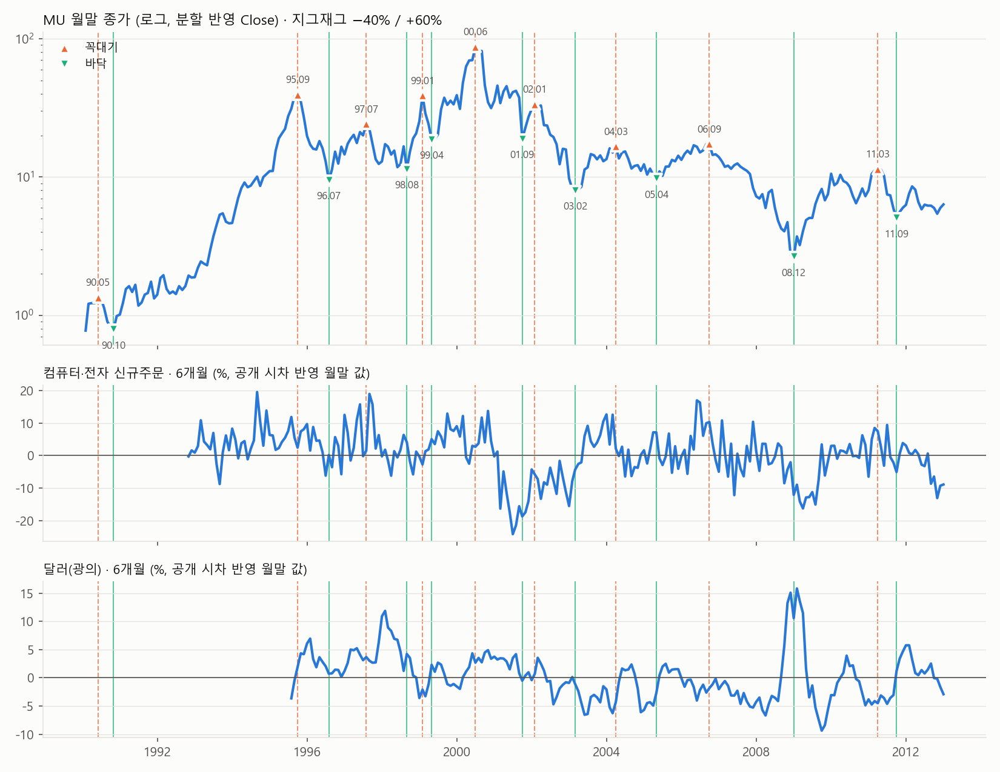

# 마이크론(MU) 사이클 해부 1단계 — 분석 보고서 (판정 없음)

> 발견 구간 1990-01 ~ 2012-12만 사용. 2013년 이후 값은 받지도 읽지도 않았다(요청 끝 날짜 2012-12-31 + 읽을 때 날짜 차단). 매매 전략 수익률은 계산하지 않았다.
> 코드 커밋 `e453e82` · 실행 `python scripts/mu_cycle_report.py` → `docs/results/mu_cycle/v1`

## 0. 데이터와 정의

- 주가: yfinance auto_adjust=False 일봉 `Close`(분할 반영, 배당 미반영 — 트레이딩뷰 기본 차트와 같은 기준). 사이클은 월말(그달 마지막 거래일) 종가.
- FRED(키 없는 fredgraph.csv, 1985-01 ~ 2012-12 요청): IPG3344S(반도체 산업생산), A34SNO(컴퓨터·전자 신규주문), INDPRO(산업생산), T10Y2Y(장단기 금리차), TWEXB(달러(광의)), ICSA(실업수당 신규청구), PCOPPUSDM(구리), FEDFUNDS(연방기금금리). 달러는 DTWEXBGS가 2006년부터라 TWEXB(1995-01 ~)를 전 구간에 씀 — 두 지수를 잇지 않음.
- 자료 시작: A34SNO 1992-02, PCOPPUSDM 1992-01, TWEXB 1995-01 → 그 전 사이클은 해당 지표 "자료 부족". 1985~1989 값은 1990년 전년비·12개월 창 계산에만 씀.
- 공개 시차: 월간 = 관측 월 + 2개월째 1일, 주간(ICSA·TWEXB) = 관측일 + 7일, 일간(T10Y2Y) = 다음 날. FRED 현재 값(수정 반영)이며 당시 발표본이 아님.
- 두 형태: 전년비(12개월)·6개월 변화. 금리·금리차(T10Y2Y·FEDFUNDS)는 %p 차이, 나머지는 증가율 %.
- 지그재그(사전 고정): 월말 종가가 직전 꼭대기에서 −40% 이상이면 그 꼭대기 확정, 바닥에서 +60% 이상이면 그 바닥 확정. 사후에 확정되는 표시라 신호로 쓰지 않음. 창 첫 달(MU 1990-01, MCHP 1993-03)에 찍힌 점은 그 전을 볼 수 없어 빼고 셈.
- 선행 개월: 주가 바닥(꼭대기) 달 ±12개월 안에서 지표 최저(최고)가 온 달까지 거리. + = 지표가 먼저. 창에 빈 값이 있으면 "—".
- 바닥 전환 신호(사전 정의): 지표(각 형태)가 최근 12개월(그달 포함) 최저보다 +2 이상(%p 또는 %) 높아진 첫 달. 적중 = 신호 달 ~ 12개월 뒤 안에 MU 바닥. 헛신호 = 신호 뒤 12개월 안 월말 종가 최저가 신호 달 종가보다 −20% 이상. 놓침 = 바닥 앞 12개월(바닥 달 포함)에 신호 없음. 뒤 12개월이 없는 2012년 신호는 평가 제외.
- 순위 상관: 지표와 MU 12개월 뒤 수익률(월말)의 스피어만 상관, 1990-01 ~ 2011-12.
- 재무: EDGAR companyfacts 희석 EPS 중 기간 끝·공시일이 2012-12-31 이하인 사실만 저장(원본 저장 안 함). 분기 2008-12-04 ~ 2012-08-30 분기 13개. TTM = 그날까지 알려진 마지막 4분기 합. 알게 된 날 = min(처음 공시일, 분기 끝 + 60일) — 2010년 초기 XBRL 공시가 companyfacts에 빠져 그 분기들이 1년 뒤 비교 값으로만 있어서. FY2009 2~4분기는 XBRL에 없어 TTM은 2010-11부터.

## 1. MU 사이클

### 꼭대기·바닥

| 날짜 | 종류 | 월말 종가 | 확정된 달 |
|---|---|---|---|
| 1990-05-31 | 꼭대기 | 1.35 | 1990-10-31 |
| 1990-10-31 | 바닥 | 0.79 | 1991-02-28 |
| 1995-09-30 | 꼭대기 | 39.69 | 1995-12-31 |
| 1996-07-31 | 바닥 | 9.44 | 1996-09-30 |
| 1997-07-31 | 꼭대기 | 24.25 | 1997-10-31 |
| 1998-08-31 | 바닥 | 11.38 | 1998-10-31 |
| 1999-01-31 | 꼭대기 | 39.00 | 1999-04-30 |
| 1999-04-30 | 바닥 | 18.62 | 1999-07-31 |
| 2000-06-30 | 꼭대기 | 88.06 | 2000-09-30 |
| 2001-09-30 | 바닥 | 18.83 | 2001-12-31 |
| 2002-01-31 | 꼭대기 | 33.75 | 2002-06-30 |
| 2003-02-28 | 바닥 | 7.99 | 2003-07-31 |
| 2004-03-31 | 꼭대기 | 16.71 | 2005-04-30 |
| 2005-04-30 | 바닥 | 9.71 | 2006-04-30 |
| 2006-09-30 | 꼭대기 | 17.40 | 2007-11-30 |
| 2008-12-31 | 바닥 | 2.64 | 2009-04-30 |
| 2011-03-31 | 꼭대기 | 11.47 | 2011-08-31 |
| 2011-09-30 | 바닥 | 5.04 | 2012-02-29 |

### 사이클별

| 꼭대기 | 바닥 | 하락폭 | 하락 기간(개월) | 회복 기간(개월) | 다음 꼭대기 | 상승폭 | 사이클 길이(개월) | 하락 구간 벤치 대비(%p) | 상승 구간 벤치 대비(%p) |
|---|---|---|---|---|---|---|---|---|---|
| 1990-05-31 | 1990-10-31 | -41.7% | 5 | 4 | 1995-09-30 | 4939.7% | 64 | -14 | +4723 |
| 1995-09-30 | 1996-07-31 | -76.2% | 10 | 43 | 1997-07-31 | 157.0% | 22 | -80 | +109 |
| 1997-07-31 | 1998-08-31 | -53.1% | 13 | 4 | 1999-01-31 | 242.9% | 18 | -47 | +176 |
| 1999-01-31 | 1999-04-30 | -52.2% | 3 | 8 | 2000-06-30 | 372.8% | 17 | -53 | +299 |
| 2000-06-30 | 2001-09-30 | -78.6% | 15 | 미회복(2012 말까지) | 2002-01-31 | 79.2% | 19 | -10 | +46 |
| 2002-01-31 | 2003-02-28 | -76.3% | 13 | 미회복(2012 말까지) | 2004-03-31 | 109.1% | 26 | -42 | +67 |
| 2004-03-31 | 2005-04-30 | -41.9% | 13 | 12 | 2006-09-30 | 79.2% | 30 | -39 | +63 |
| 2006-09-30 | 2008-12-31 | -84.8% | 27 | 미회복(2012 말까지) | 2011-03-31 | 334.5% | 54 | -58 | +241 |
| 2011-03-31 | 2011-09-30 | -56.1% | 6 | 미회복(2012 말까지) | — | — | — | -47 | — |

- 꼭대기 → 다음 꼭대기 평균 31.2개월 (중앙값 24, 완결 8개)
- 하락폭: 평균 -62.3%, 중앙값 -56.1%, 가장 얕음 -41.7%, 가장 깊음 -84.8% (사이클 9개)
- 하락 기간 평균 11.7개월, 상승 구간 평균 상승폭 789.3%
- 벤치(1999-03까지 ^IXIC, 그 뒤 QQQ) 대비: 하락 구간 평균 -43%p, 상승 구간 평균 +716%p

## 2. 선행 지표 (MU)

괄호 안 숫자는 사이클 순서(1990년부터). 적중률 = 적중/평가 신호, 놓침 = 놓친 바닥/평가 바닥, 헛신호 = 헛신호/평가 신호.

**적중률 기준선 41%**: 평가 가능한 아무 달에 신호를 냈어도 12개월 안에 MU 바닥이 있었을 비율(바닥이 자주 와서 높다). 적중률은 이 값과 비교해 읽는다. 선행 개월 ±12는 찾는 창의 끝이라 "창 안에 뚜렷한 극값 없음"에 가깝다.

| 지표 | 형태 | 바닥 선행(사이클별) | 바닥 중앙값 | 꼭대기 선행(사이클별) | 꼭대기 중앙값 | 선행 양수 비율 | 신호 | 적중률 | 놓침 | 헛신호 | 순위 상관(12개월 뒤) |
|---|---|---|---|---|---|---|---|---|---|---|---|
| 반도체 산업생산 | 전년비 | +8, +10, +1, +9, -4, +12, +3, -4, -6 | 3.0 | +0, -12, +10, -8, +9, +11, +2, -12, +8 | 2.0 | 61% | 11 | 36% (4/11) | 4/9 | 5/11 | -0.08 |
| 반도체 산업생산 | 6개월 | +0, +10, +1, -11, +0, +12, +3, -3, +0 | 0.0 | +4, -7, +12, -1, +9, +12, +3, -12, +10 | 4.0 | 56% | 14 | 29% (4/14) | 3/9 | 7/14 | -0.11 |
| 컴퓨터·전자 신규주문 | 전년비 | —, -7, -1, +7, -6, +11, +4, -3, -11 | -2.0 | —, +7, -4, -11, -2, +12, +3, -4, -9 | -3.0 | 38% | 23 | 57% (13/23) | 1/8 | 12/23 | -0.03 |
| 컴퓨터·전자 신규주문 | 6개월 | —, +1, +5, +6, +3, +2, +10, -3, -11 | 2.5 | —, +10, -1, -8, -4, +12, +3, +4, -3 | 1.0 | 62% | 26 | 54% (14/26) | 0/8 | 14/26 | 0.04 |
| 산업생산 | 전년비 | -7, +4, -5, +3, -4, +12, +11, -8, +2 | 2.0 | -4, +7, -5, +10, +9, -12, -12, -2, +7 | -2.0 | 50% | 14 | 43% (6/14) | 4/9 | 7/14 | 0.13 |
| 산업생산 | 6개월 | -7, +10, -1, +7, +0, +12, -7, -3, +5 | 0.0 | +0, -12, -6, +12, +4, -7, -11, +4, +8 | 0.0 | 44% | 21 | 43% (9/21) | 3/9 | 11/21 | 0.15 |
| 장단기 금리차 | 전년비 | +12, +10, +2, -12, +12, -11, -1, -3, -9 | -1.0 | -12, -12, +10, +3, -11, +3, +12, -12, +12 | 3.0 | 50% | 2 | 100% (2/2) | 7/9 | 2/2 | -0.09 |
| 장단기 금리차 | 6개월 | +9, -12, +9, -11, -7, -11, +2, +4, -3 | -3.0 | -5, +3, +10, +3, -11, +8, +12, -12, +1 | 3.0 | 56% | 0 | — (0/0) | 9/9 | 0/0 | -0.18 |
| 달러(광의) | 전년비 | —, —, -12, -4, -10, -12, -1, +9, +4 | -4.0 | —, —, -11, +7, -9, +10, -2, +10, -12 | -2.0 | 36% | 14 | 36% (5/14) | 2/7 | 10/14 | 0.23 |
| 달러(광의) | 6개월 | —, +12, -4, +4, -10, -3, +5, -9, +10 | 0.5 | —, —, -6, +12, -4, +6, -5, +10, -9 | -4.0 | 47% | 16 | 50% (8/16) | 0/7 | 10/16 | 0.19 |
| 실업수당 신규청구 | 전년비 | -12, -8, -10, -2, -12, -12, +12, -12, +7 | -10.0 | -10, -4, -11, +7, -10, +3, +11, +12, +2 | 2.0 | 39% | 18 | 28% (5/18) | 5/9 | 11/18 | -0.12 |
| 실업수당 신규청구 | 6개월 | -11, +0, -4, +4, -7, -9, -11, -12, +7 | -7.0 | -7, -6, -11, +7, -10, +9, +11, +12, -5 | -5.0 | 33% | 18 | 44% (8/18) | 3/9 | 11/18 | -0.08 |
| 구리 | 전년비 | —, -2, +0, +8, -3, +12, -1, -4, -12 | -1.5 | —, +7, -2, -12, +3, -12, -3, +2, +12 | 0.0 | 38% | 10 | 40% (4/10) | 4/8 | 5/10 | -0.31 |
| 구리 | 6개월 | —, -1, +6, +12, -2, +12, +5, -2, -3 | 2.0 | —, +12, +2, -10, +7, -5, -2, +2, +0 | 1.0 | 50% | 18 | 44% (8/18) | 2/8 | 13/18 | -0.23 |
| 연방기금금리 | 전년비 | -12, +1, -7, +1, -5, +12, +10, -1, -3 | -1.0 | +12, +5, -3, -12, -2, +11, -12, +11, +3 | 3.0 | 50% | 6 | 17% (1/6) | 8/9 | 2/6 | -0.21 |
| 연방기금금리 | 6개월 | -8, +0, -7, +1, +1, +12, +12, +5, +2 | 1.0 | +12, +5, -3, -12, -2, +12, -11, +7, +9 | 5.0 | 61% | 2 | 50% (1/2) | 8/9 | 1/2 | -0.11 |

## 3. 경기순환주 특징 (MU, 단계별)

변동성 = 창 안 일간 종가 수익률 표준편차 × √252. 거래량 변화 = 창 평균 거래량 ÷ 그 앞 6개월 평균 − 1. PER = 월말 종가 ÷ TTM 희석 EPS(흑자 달만), EDGAR 2009~2012 범위.

| 단계 | 평균 연율 변동성 | 평균 거래량 변화(앞 6개월 대비) | 표본(창) | 평균 PER | 적자 달 수 |
|---|---|---|---|---|---|
| 꼭대기 전 6개월 | 58.0% | -4.0% | 9 | 5.4 (창 1개) | 0 |
| 꼭대기 후 6개월 | 65.7% | 4.8% | 9 | 8.3 (창 1개) | 0 |
| 바닥 전 6개월 | 69.6% | -0.9% | 9 | 8.0 (창 1개) | 0 |
| 바닥 후 6개월 | 67.9% | 4.5% | 9 | 39.7 (창 1개) | 3 |

### 창별 값

| 단계 | 기준 점 | 변동성 | 거래량 변화 | 평균 PER | 적자 달 |
|---|---|---|---|---|---|
| 꼭대기 전 6개월 | 1990-05-31 | 57.1% | -21.3% | 자료 없음 | 0 |
| 꼭대기 후 6개월 | 1990-05-31 | 64.6% | -36.4% | 자료 없음 | 0 |
| 바닥 전 6개월 | 1990-10-31 | 56.6% | 1.9% | 자료 없음 | 0 |
| 바닥 후 6개월 | 1990-10-31 | 67.0% | 10.0% | 자료 없음 | 0 |
| 꼭대기 전 6개월 | 1995-09-30 | 52.5% | 11.6% | 자료 없음 | 0 |
| 꼭대기 후 6개월 | 1995-09-30 | 68.4% | 52.0% | 자료 없음 | 0 |
| 바닥 전 6개월 | 1996-07-31 | 62.4% | -19.0% | 자료 없음 | 0 |
| 바닥 후 6개월 | 1996-07-31 | 71.7% | 5.4% | 자료 없음 | 0 |
| 꼭대기 전 6개월 | 1997-07-31 | 53.0% | -8.4% | 자료 없음 | 0 |
| 꼭대기 후 6개월 | 1997-07-31 | 72.8% | -6.1% | 자료 없음 | 0 |
| 바닥 전 6개월 | 1998-08-31 | 64.5% | -10.6% | 자료 없음 | 0 |
| 바닥 후 6개월 | 1998-08-31 | 77.6% | 20.8% | 자료 없음 | 0 |
| 꼭대기 전 6개월 | 1999-01-31 | 75.6% | 20.6% | 자료 없음 | 0 |
| 꼭대기 후 6개월 | 1999-01-31 | 79.1% | 4.6% | 자료 없음 | 0 |
| 바닥 전 6개월 | 1999-04-30 | 77.6% | 31.9% | 자료 없음 | 0 |
| 바닥 후 6개월 | 1999-04-30 | 74.2% | 5.8% | 자료 없음 | 0 |
| 꼭대기 전 6개월 | 2000-06-30 | 91.7% | -23.1% | 자료 없음 | 0 |
| 꼭대기 후 6개월 | 2000-06-30 | 97.0% | -6.7% | 자료 없음 | 0 |
| 바닥 전 6개월 | 2001-09-30 | 76.5% | -17.3% | 자료 없음 | 0 |
| 바닥 후 6개월 | 2001-09-30 | 72.3% | -2.3% | 자료 없음 | 0 |
| 꼭대기 전 6개월 | 2002-01-31 | 77.9% | -13.8% | 자료 없음 | 0 |
| 꼭대기 후 6개월 | 2002-01-31 | 74.9% | 13.5% | 자료 없음 | 0 |
| 바닥 전 6개월 | 2003-02-28 | 78.0% | 12.5% | 자료 없음 | 0 |
| 바닥 후 6개월 | 2003-02-28 | 54.7% | 8.7% | 자료 없음 | 0 |
| 꼭대기 전 6개월 | 2004-03-31 | 36.2% | 0.6% | 자료 없음 | 0 |
| 꼭대기 후 6개월 | 2004-03-31 | 38.3% | -21.5% | 자료 없음 | 0 |
| 바닥 전 6개월 | 2005-04-30 | 29.1% | -9.6% | 자료 없음 | 0 |
| 바닥 후 6개월 | 2005-04-30 | 32.1% | 6.7% | 자료 없음 | 0 |
| 꼭대기 전 6개월 | 2006-09-30 | 35.2% | -7.6% | 자료 없음 | 0 |
| 꼭대기 후 6개월 | 2006-09-30 | 33.2% | 41.6% | 자료 없음 | 0 |
| 바닥 전 6개월 | 2008-12-31 | 119.6% | 0.3% | 자료 없음 | 0 |
| 바닥 후 6개월 | 2008-12-31 | 92.0% | 1.0% | 자료 없음 | 0 |
| 꼭대기 전 6개월 | 2011-03-31 | 42.6% | 5.1% | 5.4 | 0 |
| 꼭대기 후 6개월 | 2011-03-31 | 62.6% | 1.8% | 8.3 | 0 |
| 바닥 전 6개월 | 2011-09-30 | 62.4% | 1.5% | 8.0 | 0 |
| 바닥 후 6개월 | 2011-09-30 | 69.4% | -15.9% | 39.7 | 3 |

### 꼭대기·바닥 PER ("꼭대기에서 PER 낮고 바닥에서 PER 높다" 확인)

| 점 | 날짜 | 종가 | TTM 희석 EPS | PER | 비고 |
|---|---|---|---|---|---|
| 꼭대기 | 1990-05-31 | 1.35 | — | — | 자료 없음 |
| 바닥 | 1990-10-31 | 0.79 | — | — | 자료 없음 |
| 꼭대기 | 1995-09-30 | 39.69 | — | — | 자료 없음 |
| 바닥 | 1996-07-31 | 9.44 | — | — | 자료 없음 |
| 꼭대기 | 1997-07-31 | 24.25 | — | — | 자료 없음 |
| 바닥 | 1998-08-31 | 11.38 | — | — | 자료 없음 |
| 꼭대기 | 1999-01-31 | 39.00 | — | — | 자료 없음 |
| 바닥 | 1999-04-30 | 18.62 | — | — | 자료 없음 |
| 꼭대기 | 2000-06-30 | 88.06 | — | — | 자료 없음 |
| 바닥 | 2001-09-30 | 18.83 | — | — | 자료 없음 |
| 꼭대기 | 2002-01-31 | 33.75 | — | — | 자료 없음 |
| 바닥 | 2003-02-28 | 7.99 | — | — | 자료 없음 |
| 꼭대기 | 2004-03-31 | 16.71 | — | — | 자료 없음 |
| 바닥 | 2005-04-30 | 9.71 | — | — | 자료 없음 |
| 꼭대기 | 2006-09-30 | 17.40 | — | — | 자료 없음 |
| 바닥 | 2008-12-31 | 2.64 | — | — | 자료 없음 |
| 꼭대기 | 2011-03-31 | 11.47 | 1.78 | 6.4 |  |
| 바닥 | 2011-09-30 | 5.04 | 0.61 | 8.3 |  |

확인 가능한 점: 꼭대기 2011-03-31 PER 6.4; 바닥 2011-09-30 PER 8.3

## 4. 확인용 동료 5곳 (같은 2·3번 적용, 요약)

| 종목 | 자료 시작 | 바닥 수 | 꼭대기 수 | 바닥 날짜 |
|---|---|---|---|---|
| AMAT | 1990-01-31 | 6 | 6 | 1990-10, 1996-07, 1998-08, 2001-09, 2002-09, 2009-02 |
| LRCX | 1990-01-31 | 7 | 8 | 1990-10, 1996-07, 1998-09, 2000-12, 2001-09, 2002-09, 2009-02 |
| KLAC | 1990-01-31 | 9 | 8 | 1990-02, 1990-11, 1992-08, 1996-07, 1998-08, 2000-11, 2001-09, 2002-09, 2009-02 |
| TXN | 1990-01-31 | 4 | 4 | 1990-10, 1996-07, 2002-09, 2009-02 |
| MCHP | 1993-03-31 | 3 | 3 | 1998-08, 2000-12, 2008-11 |

| 지표 | 형태 | MU 적중률 | MU 놓침 | MU 바닥 선행 중앙 | AMAT 적중률 | LRCX 적중률 | KLAC 적중률 | TXN 적중률 | MCHP 적중률 | 동료 평균 적중률 | 동료 바닥 선행 중앙(전체) | 선행 방향 MU와 같은 동료 |
|---|---|---|---|---|---|---|---|---|---|---|---|---|
| 반도체 산업생산 | 전년비 | 36% | 4/9 | 3.0 | 27% | 36% | 45% | 18% | 25% | 30% | 2.0 | 4/5 |
| 반도체 산업생산 | 6개월 | 29% | 3/9 | 0.0 | 21% | 29% | 36% | 14% | 17% | 23% | 0.0 | 1/5 |
| 컴퓨터·전자 신규주문 | 전년비 | 57% | 1/8 | -2.0 | 48% | 48% | 48% | 26% | 13% | 37% | -1.0 | 5/5 |
| 컴퓨터·전자 신규주문 | 6개월 | 54% | 0/8 | 2.5 | 35% | 38% | 38% | 19% | 15% | 29% | 1.0 | 4/5 |
| 산업생산 | 전년비 | 43% | 4/9 | 2.0 | 29% | 29% | 43% | 21% | 9% | 26% | -5.0 | 0/5 |
| 산업생산 | 6개월 | 43% | 3/9 | 0.0 | 19% | 19% | 19% | 14% | 5% | 15% | -1.0 | 1/5 |
| 장단기 금리차 | 전년비 | 100% | 7/9 | -1.0 | 100% | 100% | 100% | 50% | 50% | 80% | 7.0 | 0/5 |
| 장단기 금리차 | 6개월 | — | 9/9 | -3.0 | — | — | — | — | — | — | 6.0 | 2/5 |
| 달러(광의) | 전년비 | 36% | 2/7 | -4.0 | 21% | 21% | 21% | 21% | 7% | 19% | -8.0 | 3/5 |
| 달러(광의) | 6개월 | 50% | 0/7 | 0.5 | 31% | 38% | 38% | 19% | 19% | 29% | -7.0 | 0/5 |
| 실업수당 신규청구 | 전년비 | 28% | 5/9 | -10.0 | 17% | 17% | 33% | 17% | 7% | 18% | -10.0 | 5/5 |
| 실업수당 신규청구 | 6개월 | 44% | 3/9 | -7.0 | 22% | 28% | 28% | 17% | 0% | 19% | -4.0 | 5/5 |
| 구리 | 전년비 | 40% | 4/8 | -1.5 | 40% | 50% | 40% | 20% | 10% | 32% | -2.0 | 5/5 |
| 구리 | 6개월 | 44% | 2/8 | 2.0 | 39% | 44% | 44% | 22% | 17% | 33% | 0.0 | 0/5 |
| 연방기금금리 | 전년비 | 17% | 8/9 | -1.0 | 17% | 33% | 33% | 17% | 17% | 23% | -5.0 | 4/5 |
| 연방기금금리 | 6개월 | 50% | 8/9 | 1.0 | 50% | 50% | 50% | 50% | 0% | 40% | 0.0 | 3/5 |

## 5. 다음 단계 사전 등록 후보

순위 규칙(결과 전 고정): 평가 신호 3번 이상·바닥 선행 표본 3개 이상인 지표·형태 중 점수 = 선행 양수 비율 + 적중률 − 놓침 비율 − 헛신호 비율이 큰 순, 같으면 바닥 선행 IQR이 작은 순. 표본이 사이클 몇 개뿐이라 순위는 다음 단계에서 시험할 가설 후보일 뿐 판정이 아니다.

1. **컴퓨터·전자 신규주문 · 6개월** — 점수 0.62. 바닥 선행 —, +1, +5, +6, +3, +2, +10, -3, -11개월(중앙 2.5, IQR 5.2), 꼭대기 선행 —, +10, -1, -8, -4, +12, +3, +4, -3개월, 선행 양수 비율 62%; 신호 26번 중 적중 14·헛신호 14, 놓침 0/8. 동료 평균 적중률 29%, 선행 방향 같은 동료 4/5.
2. **달러(광의) · 6개월** — 점수 0.34. 바닥 선행 —, +12, -4, +4, -10, -3, +5, -9, +10개월(중앙 0.5, IQR 11.5), 꼭대기 선행 —, —, -6, +12, -4, +6, -5, +10, -9개월, 선행 양수 비율 47%; 신호 16번 중 적중 8·헛신호 10, 놓침 0/7. 동료 평균 적중률 29%, 선행 방향 같은 동료 0/5.
3. **컴퓨터·전자 신규주문 · 전년비** — 점수 0.29. 바닥 선행 —, -7, -1, +7, -6, +11, +4, -3, -11개월(중앙 -2.0, IQR 11.0), 꼭대기 선행 —, +7, -4, -11, -2, +12, +3, -4, -9개월, 선행 양수 비율 38%; 신호 23번 중 적중 13·헛신호 12, 놓침 1/8. 동료 평균 적중률 37%, 선행 방향 같은 동료 5/5.

